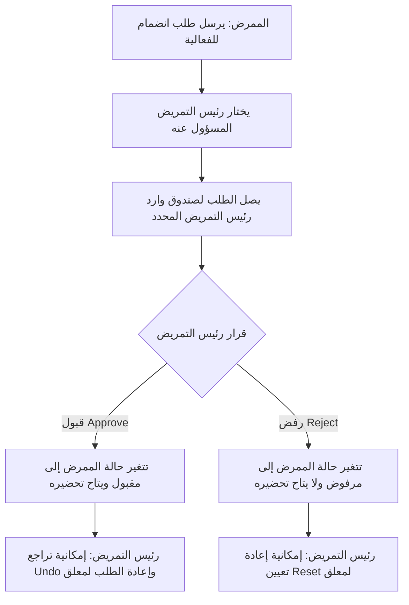

# تقرير ملخص المنصة وإرشاد المسؤولين (NurSync Platform Handover Report)

مرحباً بك في دليل تشغيل وإدارة منصة **NurSync** المخصصة لتنظيم الأنشطة، الدورات، والنشرات الطبية الدورية وتتبع حضور الكادر التمريضي في التجمع الصحي. تم تصميم هذا المستند لتقديمه إلى المسؤولين وأصحاب المصلحة لفهم آلية عمل النظام وصلاحيات كل مستخدم بشكل منظم وواضح.

---

## 1. هيكل الأدوار والصلاحيات (Roles & Privileges Matrix)

تم تنظيم النظام ليحتوي على **4 أدوار أساسية** تضمن سير العمل الإداري والأكاديمي بسلاسة:

| الصلاحية / الميزة | الممرض (Nurse) | رئيس التمريض (Head Nurse) | المدير (Manager) | المشرف العام (Admin) |
| :--- | :---: | :---: | :---: | :---: |
| **استعراض الأنشطة والنشرات** | ✅ | ✅ | ✅ | ✅ |
| **طلب الانضمام للأنشطة** | ✅ (يتطلب موافقة) | ✅ (قبول تلقائي) | ✅ (قبول تلقائي) | ✅ (قبول تلقائي) |
| **تنزيل الملخصات والعروض** | ✅ | ✅ | ✅ | ✅ |
| **اعتماد طلبات موظفيه (Approve/Reject)** | ❌ | ✅ (لمستشفاه فقط) | ✅ (لكل التجمع) | ✅ (لكل التجمع) |
| **رصد الحضور والغياب (Attendance)** | ❌ | ✅ (لأنشطة مستشفاه) | ✅ (لكل التجمع) | ✅ (لكل التجمع) |
| **إضافة/تعديل/حذف الأنشطة** | ❌ | ✅ (لمستشفاه فقط) | ✅ (لكل التجمع) | ✅ (لكل التجمع) |
| **رفع وحذف النشرات الطبية (PDF)** | ❌ | ❌ | ✅ | ✅ |
| **التحكم بالمنصة وإعدادات النظام** | ❌ | ❌ | ❌ | ✅ |

---

## 2. أمن تسجيل الحسابات وحماية المنصة (Security & Access Control)

لضمان عدم تلاعب أي مستخدم بالرتب الحساسة، تم تطبيق نظام حماية صارم عند إنشاء الحسابات:

* **الرموز السرية للتسجيل (Registration Passcodes)**: 
  لا يمكن لأي مستخدم إنشاء حساب برتبة معينة إلا إذا أدخل "الرمز السري المخصص" لتلك الرتبة عند التسجيل، والرموز هي:
  * رتبة ممرض (**Nurse**): `NURSE2026`
  * رتبة رئيس تمريض (**Head Nurse**): `HN2026`
  * رتبة مدير (**Manager**): `MGR2026`
  * رتبة مشرف (**Admin**): حساب خاص ومغلق لا يمكن التسجيل به للعامة (يُنشأ يدوياً من قاعدة البيانات أو عبر حساب الآدمن الرئيسي المعتمد).

* **قوة كلمة المرور (Password Complexity)**:
  يجب أن تتكون كلمة المرور لأي حساب جديد من **8 خانات على الأقل** وتشتمل على **حرف واحد ورقم واحد على الأقل** لمنع استخدام كلمات المرور الضعيفة.

* **منع التعبئة التلقائية (Anti-Autofill)**:
  تم تأمين نموذج التسجيل لمنع المتصفحات من تعبئة البيانات القديمة أو البريد الإلكتروني المحفوظ تلقائياً في الحقول.

---

## 3. دورة حياة طلب الانضمام والاعتمادات (Request & Approval Workflow)

تسير عملية طلب الانضمام إلى الأنشطة والدورات عبر الخطوات المنظمة التالية:

### تفاصيل صندوق الوارد الخاص بالاعتمادات (Approvals Inbox):
* **الطلبات المعلقة**: تظهر لرئيس التمريض مع خياري **Approve** (قبول) أو **Reject** (رفض).
* **تاريخ الإجراءات (History Logs)**: لا تختفي الطلبات بعد اتخاذ قرار بشأنها، بل تظل معروضة كأرشيف إجرائي منظم:
  * الطلبات المقبولة يظهر بجانبها زر تراجع (**Undo**) يعيدها لحالة المعلق في حال تم قبولها بالخطأ.
  * الطلبات المرفوضة يظهر بجانبها زر إعادة تعيين (**Reset**) يتيح إرجاعها لحالة المعلق لتعديل القرار.
* **إشعار الطلبات المعلقة**: يظهر عداد رقمي باللون أحمر بجانب تبويب الاعتمادات يوضح عدد الطلبات التي **ينتظر اتخاذ إجراء بشأنها فقط**، لتنبيه الإدارة بالطلبات المتأخرة.

---

## 4. نظام النشرات الطبية الدورية (Periodical Bulletins)

تعتبر النشرات الدورية أداة تعليمية وتوجيهية رئيسية في المنصة:
* يملك **المدير** و**المشرف العام** صلاحية حصرية لرفع هذه النشرات كملفات PDF مباشرة من لوحة التحكم لتظهر في الصفحة الرئيسية لجميع المستخدمين.
* يمكن للمشرفين والمدراء حذف النشرات القديمة لتحديث المحتوى بشكل مستمر.

---

## 5. بيانات حساب المسؤول (Admin Account Information)
للدخول بصلاحية المشرف العام لإدارة المنصة، يتم استخدام البريد المعتمد للمسؤول:
* **البريد الإلكتروني للآدمن**: `admin@nursync.com`
* **كلمة المرور**: [تم التعيين من قِبل المشرف ويتم تزويد المسؤول بها عبر قناة اتصال آمنة]
*(يُنصح بتحديث كلمة المرور فوراً من صفحة الملف الشخصي Profile عند استلام الحساب).*
